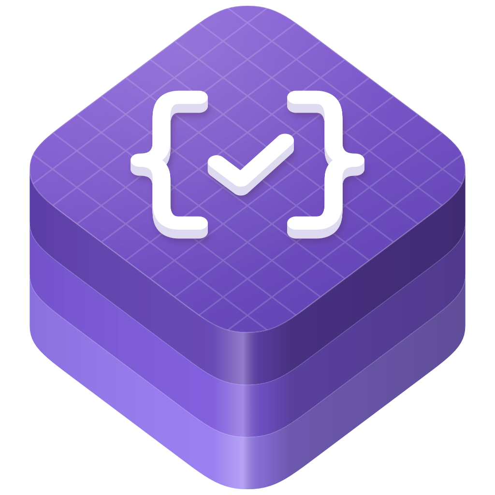

<div align="center">

<p align="center">
  <a href="https://github.com/swift-library/swift-json-schema"></a>
</p>

<h1 align="center">swift-json-schema</h1>

<p align="center">
  Validate JSON against JSON Schema without losing number precision.
</p>

<p align="center">
  <a href="https://github.com/swift-library/swift-json-schema/actions/workflows/ci.yml"></a>
  
  
  <a href="LICENSE.txt"></a>
</p>

<p align="center">
  <a href="#overview">Overview</a> ·
  <a href="#quick-look">Quick look</a> ·
  <a href="#install">Install</a> ·
  <a href="#usage">Usage</a> ·
  <a href="#requirements">Requirements</a> ·
  <a href="#documentation">Documentation</a> ·
  <a href="#contributing">Contributing</a> ·
  <a href="#license">License</a>
</p>

</div>

## Overview

Compile a schema once and reuse it for validations with separate evaluation state. Exact decimal checks distinguish `0.3` from `0.30000000000000001` for `multipleOf: 0.1`; the [usage guide](Documentation/Reference/Usage.md) covers supported drafts, output formats, and limits.

## Quick look

```swift
import JSONSchema
import JSONValue

let definition = try JSONValue.parse(#"{"type":"number","multipleOf":0.1}"#)
let validator = try SchemaCompiler().compile(definition)
print(validator.validate(try JSONValue.parse("0.3")).valid)                  // true
print(validator.validate(try JSONValue.parse("0.30000000000000001")).valid)  // false
```

## Install

This is an independent implementation. It shares the SwiftPM package identity
`swift-json-schema` with [ajevans99/swift-json-schema](https://github.com/ajevans99/swift-json-schema),
so both repositories cannot appear in the same package dependency graph.

Add the package and the products you need to `Package.swift`:

```swift
dependencies: [
  .package(
    url: "https://github.com/swift-library/swift-json-schema.git",
    .upToNextMinor(from: "0.1.1")
  ),
],
targets: [
  .target(
    name: "YourTarget",
    dependencies: [
      .product(name: "JSONValue", package: "swift-json-schema"),
      .product(name: "JSONSchema", package: "swift-json-schema"),
    ]
  ),
]
```

> [!NOTE]
> swift-json-schema is pre-1.0. Minor releases may include source-breaking
> changes, so depend on it with `.upToNextMinor(from:)`.

## Usage

Choose the JSON value, schema validation, builder, conversion, or Foundation Models product your target needs. The [usage guide](Documentation/Reference/Usage.md) covers reference resolution, schema construction, CLI commands, locked conformance results, and measured benchmarks.

## Requirements

- Swift 6.2 or later, using Swift 6 language mode.
- iOS 18+ or macOS 15+. CI also configures Linux builds and tests.
- Foundation Models bridging requires iOS 26+ or macOS 26+ and an SDK that
  provides Foundation Models. It accepts a representable subset and throws
  for unsupported shapes or keywords. Validate generated content with the
  original schema.

## Documentation

- [Usage guide](Documentation/Reference/Usage.md): examples, behavior, and limits.
- [JSON values and exact serialization](Sources/JSONValue/JSONValue.docc/GettingStarted.md)
- [Schema compilation and validation](Sources/JSONSchema/JSONSchema.docc/GettingStarted.md)
- [Schema builders and macros](Sources/JSONSchemaBuilder/JSONSchemaBuilder.docc/GettingStarted.md)
- [Foundation conversions](Sources/JSONSchemaConversion/JSONSchemaConversion.docc/GettingStarted.md)
- [Foundation Models bridge](Sources/JSONSchemaFoundationModels/JSONSchemaFoundationModels.docc/GettingStarted.md)
- [Release](Documentation/Reference/Release.md): release facts and mechanics; version rules are in VERSIONING.

## Contributing

See [Contributing](CONTRIBUTING.md). Run `Scripts/check` for formatting, tests,
the Release build, CLI checks, compiling examples, and DocC validation on macOS.

## License

[Apache-2.0 WITH Swift-exception](LICENSE.txt). Vendored test suites retain
their licenses beside the test data.
